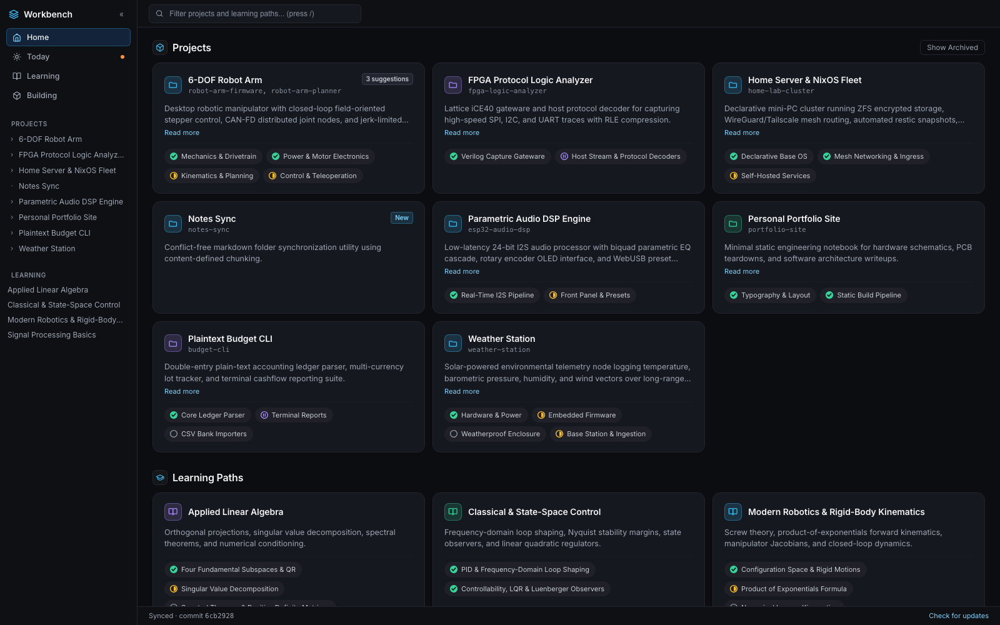
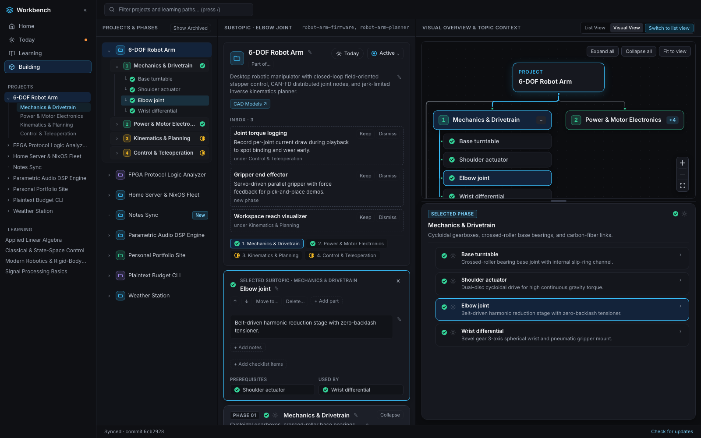
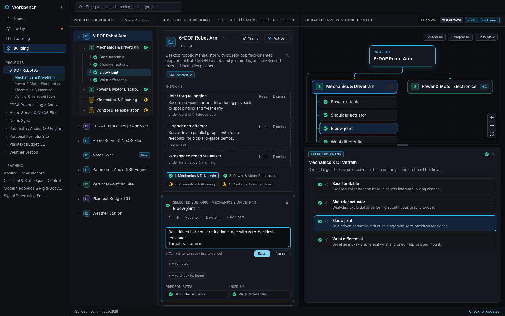

# Workbench

**A calm, Git-backed architectural map and personal dashboard for everything being built and learned.**

Workbench keeps a live visual inventory of software/hardware projects and self-directed learning paths in one place—making it easy to switch contexts, pause a build for weeks, and dive right back in without digging through scattered notes or terminal history.



---

## Table of Contents

- [Why Workbench?](#why-workbench)
- [Screenshots & Tour](#screenshots--tour)
- [Key Features](#key-features)
- [How It Works (Architecture)](#how-it-works-architecture)
- [Quick Start (60-Second Local Demo)](#quick-start-60-second-local-demo)
- [Install a Release](#install-a-release)
- [Production & Server Setup](#production--server-setup)
- [Daily Workflows](#daily-workflows)
- [CLI Reference](#cli-reference)
- [Commit Convention in `workbench-data`](#commit-convention-in-workbench-data)
- [Documentation Map](#documentation-map)
- [Contributing & Security](#contributing--security)
- [License](#license)

---

## Why Workbench?

Most project trackers assume all work happens on one linear backlog of tickets and punish context-switching with overdue badges, completion percentages, and broken streaks. At the same time, static notes and `TODO.md` files go stale because updating them manually at the end of a coding session is a chore.

Workbench is built around three principles:

1. **Architectural mental map over ticket queues:** Instead of tracking ephemeral tickets, Workbench maps the structural breakdown of each project—phases or topics, nested subtopics/components, and dependency links (`depends_on`)—with zero deadlines, streaks, percentages, or item counters.
2. **Zero-friction upkeep via coding agents:** During work in a repository with Claude Code or Gemini CLI, a lightweight lifecycle hook (`workbench hook-check`) detects changes and updates the project's YAML metadata automatically (`workbench-update` for quick per-message status/note updates, or `workbench-review` for commit milestones). With `update_mode = "headless"`, per-message updates run in a background Haiku agent so the main coding session spends zero extra tokens.
3. **Plain-text Git state with a deterministic privacy firewall:** All metadata lives in a separate private Git repository (`workbench-data`) as human-readable YAML and Markdown. Every write—whether from the CLI, an agent, or the web UI—passes strict Pydantic schema validation, semantic diff protection (blocking silent deletions or ID renames), and a secret/PII/local-path scanner before being committed.

---

## Screenshots & Tour

### Three-Panel Project Workspace & Interactive Dependency Map

Open any project to explore its phases/topics, nested components, and prerequisite graph side by side, with a resizable contextual drawer directly beneath the diagram:



### Inline Web Editing & Structure Controls

Click any status icon to update it, click the pencil (`✎`) on any title, summary, or note to edit inline, or reorder, move, add, and delete phases and components directly from the browser—every change is validated and committed to `workbench-data`:



---

## Key Features

- **Unified Projects & Learning Workspace:** View active, paused, planned, and completed projects alongside self-directed learning paths on a single dark-mode Home grid ordered by most recent activity.
- **Flexible Project Hierarchies:**
  - **Optional phases (`uses_phases: true | false`):** Organize multi-stage builds into sequential **Phases** (`uses_phases: true`), or list **Topics** directly (`uses_phases: false`) without artificial phase wrappers.
  - **Arbitrary-depth component nesting:** Nest subtopics and components (`components:`) to any depth and connect prerequisites with `depends_on`.
  - **Child projects (`parent:` / `under:`):** Attach a standalone repository as a child project under a specific phase or component of a parent project.
  - **Suggestions Inbox (`suggestions:`):** Agents can file suggested next steps into a project's inbox; click **Keep** in the dashboard to promote a suggestion into the tree or **Dismiss** to drop it.
- **Learning Paths with Markdown Notes:** Import structured study outlines from Markdown (`workbench learning import`), attach up to 20 KB of Markdown notes per topic or subtopic, and link related engineering projects (`related_projects`).
- **Automatic Repository Discovery:** Scheduled local folder scans (`workbench discover --local` via `launchd`) and daily GitHub API scans register unknown repositories automatically using their canonical root commit SHA.
- **Swappable UI Themes ("Build a Custom Look"):** The frontend separates its headless state store (`web/src/core/`) from its visual presentation layer (`web/src/ui/`). See **[web/README.md](web/README.md)** to customize colors or build a completely custom look in ~150 lines of React.

---

## How It Works (Architecture)

```text
 Laptop (CLI + Coding Agents)             GitHub                     Server (Docker / Tailscale)
┌────────────────────────────┐      ┌────────────────────┐      ┌─────────────────────────────────┐
│ Local project repositories │      │ workbench-data     │      │ Workbench FastAPI + React UI    │
│  • Agent turn / commit     │      │ (private Git repo) │      │  • Polls origin/main (10 min)   │
│    → `workbench hook-check`│ push │  ├── workbench.yaml│ fetch│  • Validates in staging tree    │
│    → `workbench set / push`├─────▶│  ├── projects/     │◀────▶│  • Atomic snapshot swap         │
│  • launchd local discovery │      │  └── learning/     │ push │  • Daily GitHub repo discovery  │
└────────────────────────────┘      └────────────────────┘      └────────────────▲────────────────┘
                                                                                 │ Tailscale IP
                                                                           Browser (User)
```

1. **Two-Repository Separation (`workbench` vs. `workbench-data`):**
   - `workbench` (this repository) contains the Python CLI, validation/privacy engine, FastAPI server, and React/TypeScript frontend.
   - `workbench-data` is the private data repository containing only `workbench.yaml`, `projects/<id>/project.yaml`, and `learning/<id>/path.yaml` (+ optional `topics/<item-id>.md` notes). The server never needs access to the source code repositories.
2. **Root-Commit Repository Identity ([`src/workbench/identity.py`](src/workbench/identity.py)):**
   - Every repository is matched to its Workbench project by its initial commit SHA (`git rev-list --max-parents=0 HEAD`) and disambiguated by its `owner/repo` GitHub remote slug on forks. Moving or renaming a folder on disk never breaks its link.
3. **Isolated Worktree Transactions ([`src/workbench/cli/`](src/workbench/cli/), [`src/workbench/server/writes/`](src/workbench/server/writes/)):**
   - Every CLI or web edit runs in a temporary Git worktree, validates the change, rebases onto `origin/main`, and pushes atomically.

---

## Quick Start (60-Second Local Demo)

### Prerequisites

- **Python 3.12+** with [uv](https://docs.astral.sh/uv/)
- **Node.js 20+** and `npm`
- **Git**

### 1. Install Dependencies

```bash
uv sync
(cd web && npm install)
```

### 2. Launch the Self-Contained Demo

```bash
make demo
```

Open **http://127.0.0.1:8420** in a browser (or set `WORKBENCH_PORT` to use a different port).

- `make demo` builds the frontend and spins up a temporary, sandboxed `workbench-data` repository seeded with sample hardware/software projects and learning paths. It never touches `~/.workbench`, `~/.claude`, or `~/.gemini`.
- Press `/` on the Home screen to filter projects and learning paths.
- Click any project card to open the three-panel workspace, drag the vertical or horizontal dividers to resize panels, and click status icons or text fields to edit them live.

---

## Install a Release

Each [GitHub Release](https://github.com/user7217/workbench/releases) provides:

| Download | Use | Guide |
| :--- | :--- | :--- |
| `Workbench_<version>_aarch64.dmg` | Desktop mode: menu-bar app on macOS (Apple silicon, unsigned) | [docs/desktop.md](docs/desktop.md) |
| `ghcr.io/user7217/workbench:<version>` | Server mode: Docker image for `linux/amd64` and `linux/arm64` | [docs/setup.md](docs/setup.md) |
| `workbench-<version>-py3-none-any.whl` | The CLI (and `workbench serve`) on the laptop: `uv tool install <wheel URL>` | [docs/setup.md](docs/setup.md) |

What changed in each version is in [CHANGELOG.md](CHANGELOG.md).

---

## Production & Server Setup

The dashboard runs in one of two ways:

- **Server mode:** Docker on an always-on machine, reachable from every device on the tailnet. See **[docs/setup.md](docs/setup.md)**.
- **Desktop mode (macOS):** a menu-bar app that runs the server on the laptop from login, reachable from that laptop only. See **[docs/desktop.md](docs/desktop.md)**.

Server mode in brief:

1. **Create a private `workbench-data` repo on GitHub** seeded with `workbench.yaml` (`schema_version: 1`).
2. **Deploy the server (Docker Compose + Tailscale):**
   ```bash
   mkdir -p secrets
   ssh-keygen -t ed25519 -C "workbench-server-deploy-key" -f secrets/deploy_key -N ""
   # Add secrets/deploy_key.pub as a Deploy Key (with write access) on the workbench-data repo
   # Create .env with WORKBENCH_DATA_REMOTE and WORKBENCH_BIND=<tailscale-ip>
   docker compose up -d --build
   ```
3. **Configure the laptop:**
   ```bash
   uv tool install .
   workbench setup
   workbench discover --local
   ```

See **[docs/setup.md](docs/setup.md)** for full step-by-step instructions, including non-Docker (`workbench serve`) deployment and headless background agent updates.

---

## Daily Workflows

### Updating Projects While Coding (Automatic)

Once `workbench setup` has installed the agent hooks:
- Work normally in any Git repository with Claude Code or Gemini CLI.
- When files change or a commit is made, the hook triggers `workbench-update` (or runs the background headless updater if `update_mode = "headless"` is enabled in `~/.workbench/config.toml`) to record status updates, implementation notes, or new suggestions in the project's inbox.
- Run `/workbench-review` (or bring a chat transcript using [`src/workbench/agents/assets/chat/PROMPT.md`](src/workbench/agents/assets/chat/PROMPT.md)) whenever a full structural reconciliation of the project is needed.

### Managing Projects from the Terminal (Manual)

```bash
# Inspect the current repository's Workbench entry (or pass --id <project-id>)
workbench show
workbench show --brief

# Update a single component's status, summary, or dependencies in one step
workbench set robot-arm can-driver --status done --summary "20 kHz FOC loop verified on hardware"

# Add a new phase/topic (omit --under) or a nested component/sub-task (pass --under)
workbench add robot-arm --under kinematics --name "Collision capsule solver" --status in_progress

# Create a brand-new standalone or child project
workbench new "Gripper Force Sensor" --parent robot-arm --under wrist-diff --status planned
```

### Importing & Updating Learning Paths

Create a Markdown outline (`# Path Name`, `## Topic`, `### Subtopic` — or generate one with [`src/workbench/agents/assets/chat/LEARNING_PROMPT.md`](src/workbench/agents/assets/chat/LEARNING_PROMPT.md)) and import or merge it without losing existing progress:

```bash
workbench learning import my-study-plan.md
workbench learning export signal-processing
```

---

## CLI Reference

| Command | Description |
| :--- | :--- |
| `workbench setup` | Interactive wizard: configures `~/.workbench/config.toml`, clones `workbench-data`, and installs agent hooks/skills |
| `workbench install --home ~ --claude --gemini` | Install or refresh Claude Code / Gemini CLI skills, hooks, and the macOS `launchd` discovery job |
| `workbench show [--id <project>] [--brief] [--item <id>]` | Print a project's full YAML, a compact 1-line-per-item summary (`--brief`), or a single subtree (`--item`) |
| `workbench focus [--set <project>[/<item>]] [--clear]` | View, set, or clear the item this repository is working on (used as a hint by the hook) |
| `workbench set <project> <item-id> [options]` | Update an item's `--status`, `--name`, `--summary`, `--notes`, or `--depends-on` and push in one step |
| `workbench add <project> [--under <id>] --name <text> [options]` | Add a top-level phase/topic, or a nested component with `--under`; also takes `--id`, `--status`, `--summary`, `--notes`, `--depends-on` |
| `workbench begin [--id <project> \| --learning <id>]` | Open an isolated Git worktree for multi-item YAML edits and print the file path |
| `workbench push <worktree> -m "<summary>" [--allow-removals]` | Validate schema, privacy, and semantic diff rules in a worktree, then rebase and push to `origin/main` |
| `workbench new "<Name>" [--learning] [--parent <id> --under <item>]` | Create a new project or learning path (optionally attached as a child project) |
| `workbench attach --id <child> --parent <id> --under <item>` | Attach an existing project under a parent project's phase or component |
| `workbench detach --id <child>` | Detach a child project back to top-level |
| `workbench link --id <project>` | Link the current Git repository to an existing project (and clean up any empty discovered stub) |
| `workbench discover --local` | Scan the local scan roots for repositories the user owns and register unknown ones (GitHub discovery runs on the server) |
| `workbench archive-empty [--dry-run] [--keep <id>]` | Archive unpopulated `origin: discovered` project stubs |
| `workbench learning import <file.md\|.yaml>` / `export <id>` | Import/merge a learning path outline from Markdown/YAML or export an existing path to Markdown |
| `workbench history [--kind K] [--project P] [-n N]` | View recent commits in `workbench-data` filtered by commit kind or project/learning scope |
| `workbench undo <commit-sha>` | Revert a specific commit in `workbench-data` and push the revert to `origin/main` |
| `workbench validate [<path>]` | Validate one metadata file or a whole `workbench-data` checkout (default: the local clone) without pushing |
| `workbench serve [--host H] [--port P]` | Run the FastAPI + React dashboard server directly without Docker |
| `workbench auto-update --transcript <file.jsonl> [--dry-run]` | Run the headless updater against a session transcript, inside the project's repo (`--dry-run` changes nothing) |
| `workbench hook-check [--mark-seen]` | The agent hook's entry point; `--mark-seen` records that the current changes need no update |

---

## Commit Convention in `workbench-data`

Every automated or manual write to `workbench-data` uses a structured commit header `<kind>(<scope>): <summary>` (enforced by [`src/workbench/commitmsg.py`](src/workbench/commitmsg.py)):

| Kind | Source | Example Commit Message |
| :--- | :--- | :--- |
| `create` | `workbench new` | `create(robot-arm): new project Robot Arm` |
| `update` | `workbench set` / `add` (`workbench-update`) | `update(robot-arm/gripper): status in_progress, notes` |
| `review` | `workbench push` (`workbench-review`) | `review(robot-arm): gripper working, wrist calibration left to do` |
| `edit` | Web dashboard UI edits | `edit(robot-arm/wrist): name, summary` |
| `import` | `workbench learning import` | `import(learning/control-theory): merge into existing learning path` |
| `attach` / `detach` | `workbench attach` / `detach` | `attach(gripper-firmware): under robot-arm/gripper` |
| `link` | `workbench link` | `link(robot-arm): add repo robot-arm-firmware` |
| `archive` | `workbench archive-empty` | `archive: 3 empty discovered project(s)` |
| `discover` | Local or GitHub discovery | `discover: register 2 repo(s) via local discovery: new-tool, scratch` |
| `undo` | `workbench undo` | `undo(robot-arm/gripper): revert 1a2b3c4d` |

---

## Documentation Map

Workbench's documentation follows the [Diátaxis](https://diataxis.fr/) structure so each guide has a clear purpose:

| Document | Type | What It Covers |
| :--- | :--- | :--- |
| **[README.md](README.md)** | **Overview & Tutorial** | Project overview, screenshots, 60-second `make demo` quickstart, and CLI cheat sheet. |
| **[docs/setup.md](docs/setup.md)** | **Deployment How-To** | Step-by-step setup for `workbench-data`, SSH deploy keys, Docker Compose + Tailscale, `workbench serve`, and laptop hooks. |
| **[docs/desktop.md](docs/desktop.md)** | **Desktop How-To** | Building and using the macOS menu-bar app that runs the dashboard on the laptop. |
| **[docs/releasing.md](docs/releasing.md)** | **Maintainer How-To** | Versions, the changelog, and cutting a release with the release workflow. |
| **[CHANGELOG.md](CHANGELOG.md)** | **Release Notes** | What changed in each version. |
| **[docs/reference.md](docs/reference.md)** | **Technical Reference** | Annotated YAML schemas (`project.yaml`, `path.yaml`), `config.toml`, environment variables, HTTP API endpoints, and every CLI command with its options. |
| **[docs/architecture.md](docs/architecture.md)** | **Backend Architecture** | Python package internals, root-commit identity resolution, discovery scanners, worktree concurrency, and 3-stage validation. |
| **[web/README.md](web/README.md)** | **Frontend & Theming Guide** | How the `web/src/core/` store and `web/src/ui/` look layer are separated, and how to build a custom UI look. |
| **[CONTRIBUTING.md](CONTRIBUTING.md)** | **Contributor Guide** | Development workflow, test suite execution, schema/type generation, and code conventions. |
| **[SECURITY.md](SECURITY.md)** | **Security & Privacy Model** | Threat model, two-repository isolation, deterministic secret/path scanning, and Tailscale network boundaries. |

---

## Contributing & Security

- See **[CONTRIBUTING.md](CONTRIBUTING.md)** for local development setup, running the offline test suite (`make test`), and regenerating JSON Schemas and TypeScript types when editing [`src/workbench/models.py`](src/workbench/models.py).
- See **[SECURITY.md](SECURITY.md)** for details on Workbench's privacy firewall, credential isolation, and network binding recommendations.

## License

Workbench is released under the [MIT License](LICENSE).
