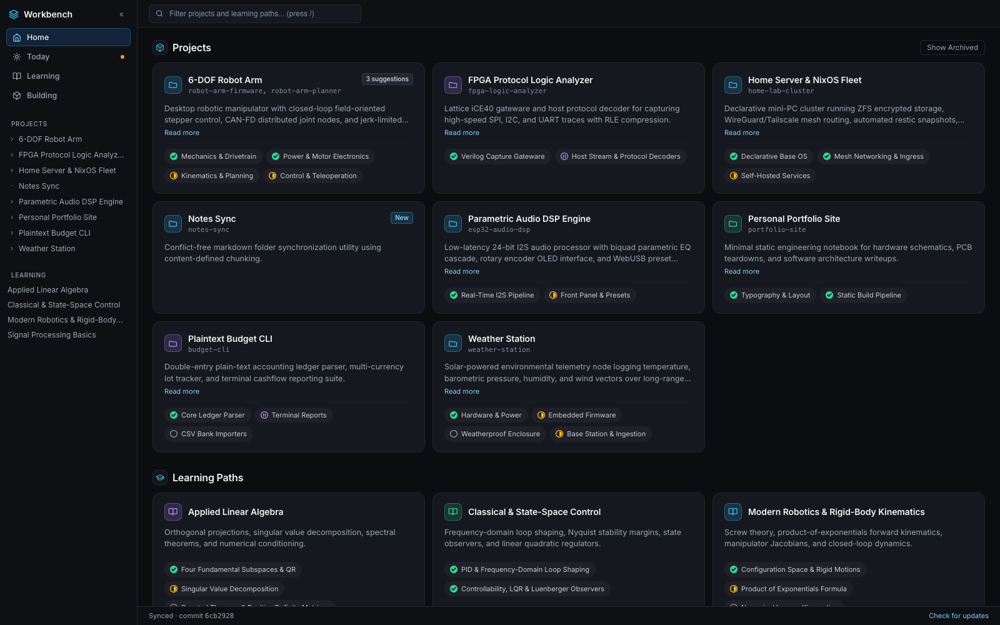
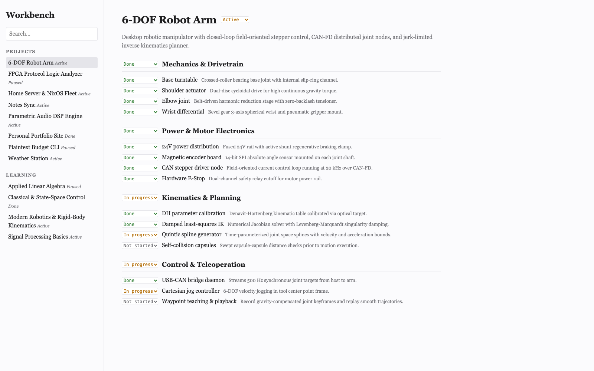
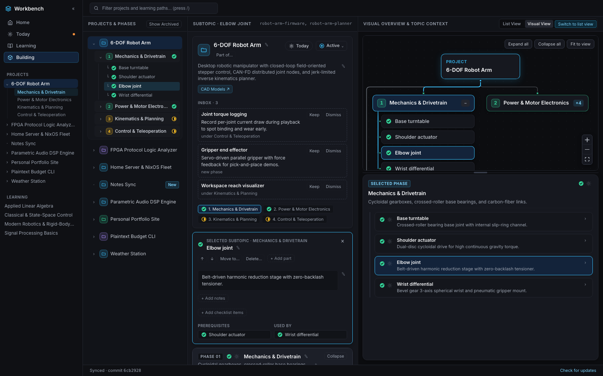
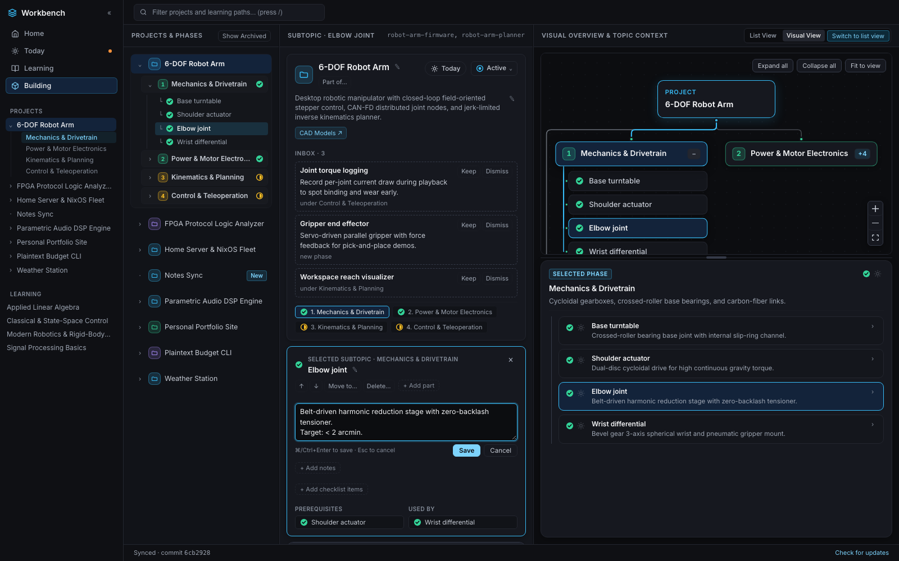

# Workbench web UI — build a custom look

The dashboard is split into a **core** that never changes and a **look** that can be replaced. This page
explains the split, gets a custom look running in a few minutes, and documents everything a look can
use.



## 1. Core vs look

| | Folder | What it owns |
|---|---|---|
| **Core** (fixed) | `src/core/` | Data loading, polling, every HTTP call (`api.ts`), the rules (`derive.ts`: project structure, child projects, listing/search, dependencies), allowed statuses (`statuses.ts`), state + actions (`store.ts`), the React binding (`react.ts`). No styling. |
| **Look** (swappable) | `src/ui/` by default | Layout, components, CSS. Reads and changes everything through `useWorkbench()`. |

Why: the rules about *what* the dashboard shows (which projects are listed, what a status may be,
how a write is saved and rolled back) are the part that has to stay correct. Keeping them in one
tested, framework-light place means a new look can be as different as desired (a single column, a
kanban, a terminal-style page) without re-implementing or breaking them.

**The one contract:** a look is a folder whose `index.tsx` default-exports a React component.
`main.tsx` mounts it inside `<WorkbenchProvider>`, so the component calls `useWorkbench()` from
`@workbench-core` and nothing else is required. Pick the folder with `WORKBENCH_UI=<path relative to
web/>` at dev or build time (default `src/ui`).

```tsx
// my-look/index.tsx — the smallest valid look
import { useWorkbench } from "@workbench-core";

export default function MyLook() {
  const wb = useWorkbench();
  return <ul>{wb.listedProjects.map((p) => <li key={p.id}>{p.name}</li>)}</ul>;
}
```

## 2. Quick start

```bash
cd web
npm install
cp -r examples/minimal-look examples/my-look       # any folder under web/ works
```

Start the demo API (artificial `demo-*` data in a throw-away folder) from the **repository root**:

```bash
WORKBENCH_PORT=8441 uv run python scripts/run_demo.py
```

Run the new look against it with hot reload (the dev server proxies `/api` to `WORKBENCH_API`):

```bash
cd web
WORKBENCH_UI=examples/my-look WORKBENCH_API=http://127.0.0.1:8441 npm run dev   # http://localhost:5173
```

Type-check and build it:

```bash
npm run typecheck:look                              # type-checks src/ and examples/ (tsconfig.looks.json)
WORKBENCH_UI=examples/my-look npm run build         # writes web/dist
```

The Python server serves whatever is in `web/dist` for every non-`/api` path, so after a build,
restarting the server (`make demo`, `scripts/run_demo.py`, or the real server) serves the new look. Run
`npm run build` without `WORKBENCH_UI` to go back to the default look.



`examples/minimal-look` (about 170 lines plus its own CSS) lists projects and learning paths, shows
a project's phases and nested components with status menus, and edits the project description.

## 3. The `useWorkbench()` reference

`useWorkbench()` returns **one object**: state fields, derived values/helpers and actions. It
re-renders on every store change. Outside React, `createWorkbench(options)` returns
`{getState, subscribe, actions, start, stop}` and `selectView(state)` gives the derived values.

### State

| Field | Type | Meaning |
|---|---|---|
| `snapshot` | `{projects, learning, topic_markdowns, today, commit, synced_at}` | Everything the server knows. `today` is `{enabled, day, entries}` (older servers omit it). |
| `syncStatus` | `{last_good_commit, last_checked_at, last_error}` | Last sync of the data repo; `last_error` = a bad commit that was skipped. |
| `route` | `{page: "home" \| "today" \| "building" \| "learning"}` or `{page: "project" \| "learning-path", id}` | Current page. |
| `selection` | `{phaseId, componentId, topicId, subtopicId}` | What is selected on the project / learning page. |
| `expanded` | `Record<ExpandKind, Record<id, boolean>>` | Open/closed sets: `projects`, `phases`, `nestedComponents`, `childProjects`, `learningPaths`, `topics`. |
| `filterText`, `showArchived` | `string`, `boolean` | Search box text; whether archived projects are shown. |
| `pending` | `Record<key, true>` | Writes in flight (see `pendingKeys`). |
| `lastError` | `{message, detail?, seq} \| null` | Last failed write. `detail` is the server's reason alone; `seq` increments per error. |

### Derived values

| Value | Meaning |
|---|---|
| `query`, `searching` | Normalised search text, and whether it is non-empty. |
| `filteredProjects`, `filteredLearning` | Matches of the search (name or description), sorted by name. |
| `listedProjects` | Projects a list should show (applies the child-project rule; includes archived — filter with `showArchived`). |
| `recentProjects`, `recentLearning` | `listedProjects` and `filteredLearning` ordered most recently changed first (the snapshot's `updated_at` git times, else the `updated` date, then name). The default Home uses these. |
| `sidebarProjects`, `sidebarLearning` | Non-archived shortcuts, ignoring the search. |
| `activeProject`, `activePhase`, `activeComponent` | The open project, its selected phase (default: first) and component (`{comp, phase, ancestors}`). |
| `activeParent` | Where the open project sits in its parent: `{parentId, parentName, phase, components}`. |
| `activeLearningPath`, `activeTopic`, `activeLearningItem`, `activeMarkdown` | Same for learning paths; `activeMarkdown` = notes of the selected topic/subtopic. |
| `projectsById`, `parentOf`, `childIndex` | Indexes over the snapshot. |

### Helpers

| Helper | Returns |
|---|---|
| `isPending(key)` | Whether a write with that key is in flight; disable its control. |
| `isExpanded(kind, id, fallback?)` | Open state, or `fallback` if never toggled. |
| `childProjectsAt(parentId, slotId)` | Child projects under a phase/component (or `ROOT_SLOT`). |
| `componentIndex(project)` | `Map<id, {comp, phase, ancestors}>` of every component at any depth. |
| `dependenciesOf(project, comp)`, `dependentsOf(project, compId)` | "Prerequisites" and "used by". |
| `componentDetails(project, comp)`, `subtopicDetails(pathId, sub)` | Level-3 rows (items, notes, deps, links). |
| `topicMarkdown(pathId, itemId)` | Markdown notes of a topic/subtopic. |
| `relatedLearning(project)`, `relatedProjects(lp)` | Cross references. |
| `projectTree(project)`, `learningTree(lp)` | Trees for maps/diagrams (include child projects). |
| `today` | Today's Work as stored: `{enabled?, day, entries: [{kind, id, item?, added}]}`. Only the chosen roots are stored. |
| `todayEnabled` | Whether Today's Work is turned on: the server sends `today` and its `enabled` is not `false`. The switch lives in `today.yaml`, so it is the same on every device. When false, a look shows no Today page and no add buttons (the default look does this). |
| `todayPlan(keepDone?)` | The roots expanded into `{groups, missing}`: one group per project or learning path, in the order they were first added and not ranked against each other. A group is `{key, kind, id, name, status, entries, whole, steps, now, next, total, done}`; each step has a `state` of `done`, `now`, `next`, `later`, `blocked` or `parked`. `todayHasWork(plan)` says whether any group has a step to do. The ordering rules are in [`../docs/today.md`](../docs/today.md). |
| `isInToday(entry)` | Whether that exact root is on the list. |

Pure functions are exported too: `getProjectGroups`, `getGroupChildren`, `projectUsesPhases`,
`locateProjectItem`, `locateItemPlacement` (parent, index and siblings — for move up/down),
`subtreeIds` (an item and its descendants — exclude them as move targets), `countDescendants`,
`getItemShortDescription`, `sortByName`, `sortByRecent`, `filterByQuery`, and more (see the comment in
`src/core/index.ts`).

### Actions

Navigation and view state:

| Action | Notes |
|---|---|
| `navigate(route)` | Project / learning-path routes behave like the two below. |
| `selectProject(projectId, phaseId?, compId?)` | `phaseId`: `undefined` = first, `null` = none. `compId` reveals the component (its phase and ancestors expand). |
| `openProjectAt(projectId, itemId?)` | Open a project focused on any phase or component id. |
| `selectLearningPath(pathId, topicId?, subtopicId?)` | Same rules for topics/subtopics. |
| `clearComponentSelection()`, `setExpanded(kind, id, open)`, `setFilter(text)`, `setShowArchived(show)` | |
| `refresh()`, `sync()` | Reload the snapshot; ask the server to pull the data repo first. |
| `dismissError()` | Clear `lastError`. |

Writes — **status** (optimistic):

| Action | Allowed statuses |
|---|---|
| `setProjectStatus(projectId, status)`, `setLearningStatus(pathId, status)` | `ENTITY_STATUSES`: planned, active, paused, done, archived |
| `setItemStatus(projectId, itemId, status)` — phase or component, any depth | `ITEM_STATUSES`: not_started, in_progress, done, parked |
| `setLearningItemStatus(pathId, itemId, status)` — topic or subtopic | `LEARNING_ITEM_STATUSES`: not_started, in_progress, done |

Writes — **text** (optimistic; each resolves `true` on success or when nothing changed, `false` on failure):

| Action | Fields |
|---|---|
| `updateProjectFields(projectId, fields)` | `{name?, description?}` |
| `updateItemFields(projectId, itemId, fields)` | `{name?, summary?, notes?, description?, items?: string[]}` — `items` only on components |
| `updateLearningFields(pathId, fields)` | `{name?, description?}` |
| `updateLearningItemFields(pathId, itemId, fields)` | `{name?, summary?, notes?, description?}` |

Only changed fields are sent. `""` (or `items: []`) removes an optional field, so a cleared field is
**missing** from the snapshot: read a missing field as `""`. A name can't be empty (rejected before
any request).

Writes — **structure** (projects only; *not* optimistic — they wait for the server's snapshot):

| Action | Notes |
|---|---|
| `addItem(projectId, {parentId, name, id?, status?, summary?, position?})` → `Promise<string \| null>` | `parentId: null` adds a phase (a topic when the project has `uses_phases: false`); a phase id adds a component; a component id adds a nested component. Resolves to the new id (the server makes it unique) so the caller can select it. |
| `moveItem(projectId, itemId, {parentId?, position})` → `Promise<boolean>` | Omit `parentId` to reorder in place. Components can move under any phase/component except themselves and their descendants; phases only reorder. |
| `deleteItem(projectId, itemId)` → `Promise<boolean>` | Permanent; removes everything nested. Refused (422) while a `depends_on` or a child project points into it — `lastError.detail` names them. Clears a selection that pointed into it. |
| `setParent(projectId, {parent, under} \| null)` → `Promise<boolean>` | Attach under a parent project's phase/component, or detach with `null`. |

Writes — **suggestions inbox** (optimistic: the row leaves the inbox at once and comes back if the
server refuses):

| Action | Notes |
|---|---|
| `keepSuggestion(projectId, suggestionId)` → `Promise<string \| null>` | Adds the suggestion to the tree as a `not_started` item under its `under` (a new phase/topic when it has none) and resolves to the new item's id. Refused (422) when the `under` item no longer exists. |
| `dismissSuggestion(projectId, suggestionId)` → `Promise<boolean>` | Removes it from the inbox. |
| `addToToday(entry)`, `removeFromToday(entry)` → `Promise<boolean>` | Put a root on Today's Work or take it off. `entry` is `{kind: "project" \| "learning", id, item?}`; without `item` it is the whole project or path. Optimistic; quick successive calls are sent as one list. |
| `setTodayEntries(entries, confirmDay = true)` → `Promise<boolean>` | Replace the list. By default it also confirms the list for the viewer's current day (the new-day review and "clear" use this). Refused locally (resolves `false` with an error) while Today's Work is turned off. |
| `setTodayEnabled(on)` → `Promise<boolean>` | Turn Today's Work on or off for every device (`POST /api/today/enabled`). Optimistic; the list is kept while it is off; a value changed again during a save is sent after it, and nothing is sent when it ends where it started. Pending key `today-enabled`. |

### Pending keys

`pendingKeys.project(id)`, `.projectItem(id, itemId)`, `.learning(id)`, `.learningItem(id, itemId)`
(status writes); `.projectFields(id)`, `.itemFields(id, itemId)`, `.learningFields(id)`,
`.learningItemFields(id, itemId)` (text edits); `.structure(projectId)` (any structure edit of that
project — one at a time); `.suggestion(projectId, suggestionId)` (Keep / Dismiss); `.today` (a save of Today's Work). A second write with a key that is already pending is ignored, except Today's Work, where the newest list is sent after the running save.

### The `optimisticWrite` pattern

Status and text edits are built on one action, also available to looks:

```ts
wb.optimisticWrite({
  key: pendingKeys.itemFields(projectId, itemId), // marks the write pending
  request: (api) => api.postJson(url, body),       // the server call
  apply: (snapshot) => /* the change, applied immediately */,
  revert: (snapshot) => /* exactly that change undone */,
  failureMessage: "Could not save edit — reverted change.",
}); // -> Promise<boolean>
```

It applies the change locally, POSTs, adopts the server's `snapshot`/`status` on success, and on
failure applies `revert` to the *then-current* snapshot (so unrelated changes that arrived meanwhile
survive) and sets `lastError`.

### Errors

Every failed write sets `lastError = {message, detail, seq}`. `message` is ready for a toast
(“Could not delete item. Cannot delete 'a': still referenced by depends_on (b -> a)”); `detail` is
the server's text alone, for showing inside a dialog. The default look shows a toast for 4 s and
calls `dismissError()`.

### Rules the core enforces

- **Child projects:** a project with `parent` (and optional `under`, a phase or component id of the
  parent) is a child only if the parent exists. Lists show a child only while it is `active` (or
  while searching); otherwise it appears inside its parent at `childProjectsAt(parent, under)`,
  or at `ROOT_SLOT` when `under` does not resolve. Statuses never roll up between parent and child.
- **Nesting:** a project has phases (or, with `uses_phases: false`, direct topics); a phase has
  components (`components`, `topics` and `subtopics` lists are treated alike); components nest to any
  depth.
- **Ids:** component ids are unique across a whole project, so every action takes just
  `(projectId, itemId)` for any depth. New ids are slugs derived from the name by the server.

## 4. Just want different colours?

A new look is not needed for that: the default look takes every colour, radius and easing from the
CSS variables in `src/ui/styles/tokens.css` (`--bg-*`, `--text-*`, `--border*`, `--accent*`,
`--status-*`, `--danger`, `--radius-*`, `--font-*`, `--shadow-*`, and `--today-now` / `--today-next` in
`styles/today.css`). Edit them and rebuild. The look ships the Inter typeface
(`@fontsource-variable/inter`, SIL Open Font License), so text looks the same on every system.

## 5. Data contract

- Schemas: [`../schema/project.schema.json`](../schema/project.schema.json),
  [`../schema/learning.schema.json`](../schema/learning.schema.json) and
  [`../schema/today.schema.json`](../schema/today.schema.json) (TypeScript types in
  `src/types/` are generated from them with `npm run generate-types`).
- Server endpoints. Writes are `POST` with headers `X-Workbench: 1` and
  `Content-Type: application/json`. Success: `{"ok": true, "snapshot": …, "status": …}` (plus
  `"item_id"` for add). Errors: `{"detail": "…"}` with 400 bad input, 403 missing header, 404 unknown
  id, 409 rebase conflict, 415 content type, 422 validation/semantic, 500 push failure.

| Method | Path | Body |
|---|---|---|
| GET | `/api/snapshot` | — |
| GET | `/api/status` | — |
| POST | `/api/sync` | `{}` |
| POST | `/api/projects/{id}/status` | `{"status"}` |
| POST | `/api/projects/{id}/items/{item}/status` | `{"status"}` |
| POST | `/api/learning/{id}/status` | `{"status"}` |
| POST | `/api/learning/{id}/items/{item}/status` | `{"status"}` |
| POST | `/api/projects/{id}/fields` | `{"name"?, "description"?}` |
| POST | `/api/projects/{id}/items/{item}/fields` | `{"name"?, "summary"?, "notes"?, "description"?, "items"?}` |
| POST | `/api/learning/{id}/fields` | `{"name"?, "description"?}` |
| POST | `/api/learning/{id}/items/{item}/fields` | `{"name"?, "summary"?, "notes"?, "description"?}` |
| POST | `/api/projects/{id}/items` | `{"parent_id", "name", "id"?, "status"?, "summary"?, "position"?}` |
| POST | `/api/projects/{id}/items/{item}/move` | `{"parent_id"?, "position"}` |
| POST | `/api/projects/{id}/items/{item}/delete` | `{"confirm": true}` |
| POST | `/api/projects/{id}/parent` | `{"parent", "under"}` (both null = detach) |
| POST | `/api/today` | `{"day": "YYYY-MM-DD", "entries": [{"kind", "id", "item"?}]}` (replaces the list) |
| POST | `/api/projects/{id}/suggestions/{suggestion}/keep` | `{}` (returns `"item_id"`) |
| POST | `/api/projects/{id}/suggestions/{suggestion}/dismiss` | `{}` |

The snapshot also carries `updated_at: {projects: {id: time}, learning: {id: time}}`, each entry's
last change time from git (older servers leave it out). A project's `suggestions` list (`Suggestion`
in the types: `id`, `name`, `summary?`, `under?`, `added`) is its inbox.

A look never needs these directly — the actions above call them — but a non-React frontend can.

## 6. The default look, editing included



Every text field has a pencil (✎): Enter saves a single-line field, Cmd/Ctrl+Enter saves a
textarea, Esc cancels. Selected components get ↑ / ↓, **Move to…**, **Delete…** and **+ Add part**;
each phase has **+ Add component** and its own ↑ / ↓ / Delete…; **+ Add phase** sits under the last
phase; **Part of…** in the project header attaches the project to a parent or detaches it. A
project with suggestions shows an **Inbox** above its phases, with **Keep** and **Dismiss** on each
row, and its Home card shows how many suggestions are waiting.



The **Settings** menu at the bottom of the sidebar (`components/SettingsMenu.tsx`, the last tab of the bottom bar on a phone) holds two preferences of a different kind:

| Setting | Kept | How |
| :--- | :--- | :--- |
| **Map layout**: vertical (the project across the top, phases in columns below it; the default) or horizontal (the project on the left, phases and parts in columns to the right) | In this browser only, since a phone and a laptop suit different layouts | Look-only state: `mapLayout` / `setMapLayout` from `useLook()` (`lookState.tsx`), stored by `layoutPrefs.ts` under `workbench_map_layout`. The map's own toolbar has the same switch beside **Fit to view**. |
| **Today's Work** on or off | In `today.yaml` (`enabled`), so for every device and server reading the same data | Core: `wb.todayEnabled` and `wb.setTodayEnabled(on)`. Off hides the Today tab and every sun and **Today** button; the stored list is kept. |

A custom look gets the Today's Work switch through `useWorkbench()` like any other action; the map layout belongs to the default look and is not part of the core.

Regenerate these screenshots (builds both looks, runs a temporary demo server, restores `web/dist`):

```bash
uv run python scripts/screenshots.py     # from the repository root
```
